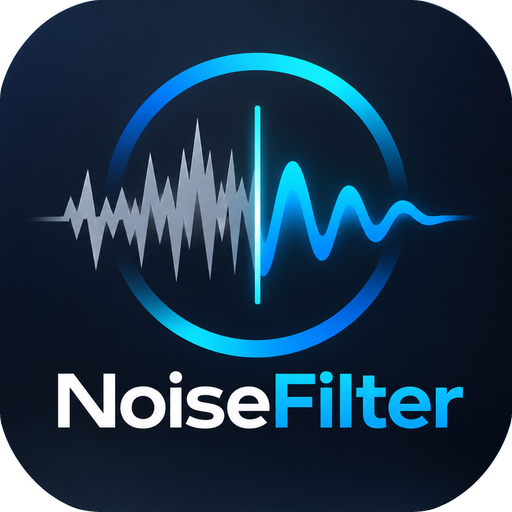
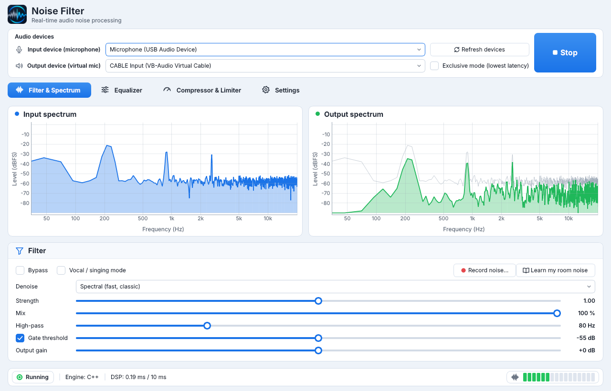
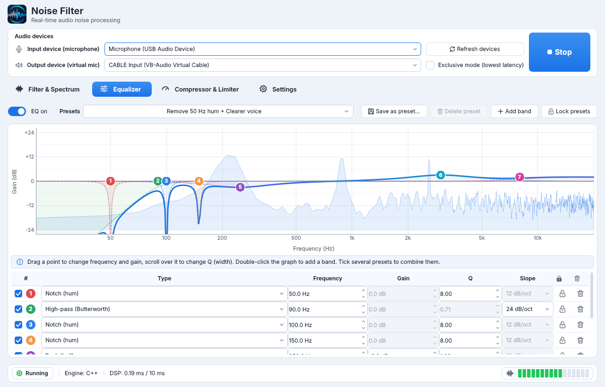
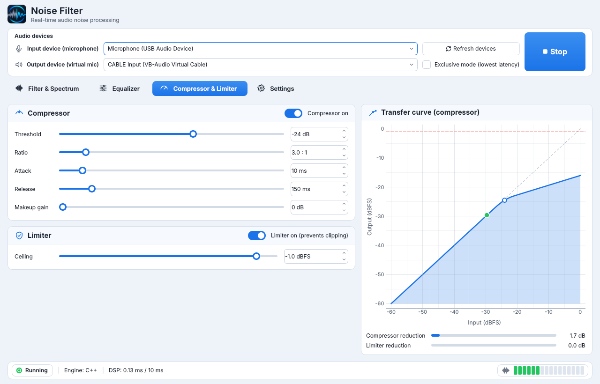
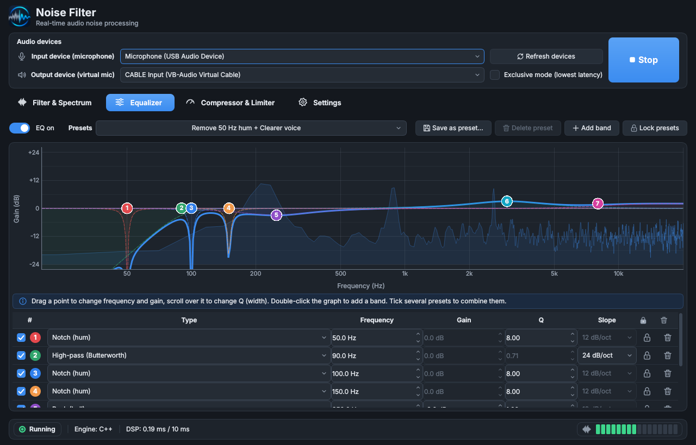
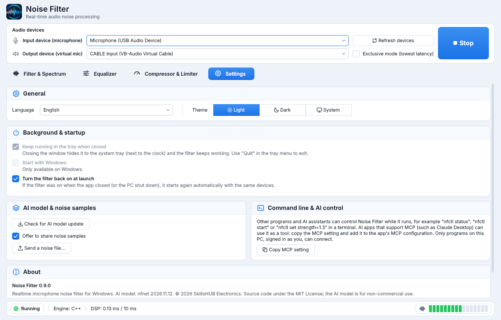
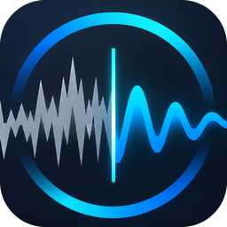

<p align="center">
  
</p>

<h1 align="center">Noise Filter</h1>

<p align="center">
  <b>Real-time microphone noise removal for Windows, with a live spectrum, an equalizer and an AI denoiser.</b>
</p>

<p align="center">
  Noise Filter sits between your microphone and your meeting app. It removes fans, air conditioning,
  traffic and mains hum in 10 ms frames, then passes the clean voice to a virtual
  microphone that Teams, Meet, Zoom, Discord, TeamTalk or OBS can pick like any other mic.<br>
  <i>By SkillsHUB Electronics.</i>
</p>

<p align="center">
  <a href="https://github.com/SkillsHUB-Electronics/Noise-Filter/releases/latest"></a>
  <a href="https://github.com/SkillsHUB-Electronics/Noise-Filter/actions/workflows/ci.yml"></a>
  
  <a href="LICENSE"></a>
  <br>
  
  
  
  <a href="https://github.com/SkillsHUB-Electronics/Noise-Filter/releases"></a>
</p>

<p align="center">
  <a href="https://github.com/SkillsHUB-Electronics/Noise-Filter/releases/latest"></a>
</p>

<br>

<p align="center">
  <picture>
    <source media="(prefers-color-scheme: dark)" srcset="docs/images/hero-dark.png">
    
  </picture>
  <br><sub><b>Filter &amp; Spectrum.</b> The input (blue) and the cleaned output (green) side by side, with the original drawn faintly behind the output.</sub>
</p>

<p align="center">
  <a href="#a-tour">A tour</a> ·
  <a href="#why-noise-filter">Why Noise Filter</a> ·
  <a href="#what-works-today">What works today</a> ·
  <a href="#install">Install</a> ·
  <a href="#quick-start-from-source">From source</a> ·
  <a href="#for-scripts-and-ai-agents">For agents</a> ·
  <a href="#architecture">Architecture</a> ·
  <a href="#roadmap">Roadmap</a> ·
  <a href="#contributing">Contributing</a> ·
  <a href="#license-privacy-and-credits">License</a>
</p>

## A tour

Every screenshot is the real app, rendered offscreen by [`tools/readme_screenshots.py`](tools/readme_screenshots.py)
from a synthetic voice-plus-noise signal, so anyone can regenerate them after a UI change.

<table>
<tr>
<td width="50%" valign="top"><p align="center"><sub><b>Equalizer.</b> Up to 8 parametric bands drawn over the live spectrum. Drag a point, scroll for Q, stack presets such as <i>50 Hz hum</i> + <i>Clearer voice</i>.</sub></p></td>
<td width="50%" valign="top"><p align="center"><sub><b>Compressor &amp; limiter.</b> Soft-knee compressor to even out loud and quiet speech, and a zero-latency limiter that stops clipping.</sub></p></td>
</tr>
<tr>
<td width="50%" valign="top"><p align="center"><sub><b>Dark mode.</b> Light, Dark, or follow Windows. English and Bahasa Indonesia.</sub></p></td>
<td width="50%" valign="top"><p align="center"><sub><b>Settings.</b> Tray and start-with-Windows, AI model updates, command-line and MCP control, and About with the privacy policy.</sub></p></td>
</tr>
</table>

## Why Noise Filter

- **Low latency.** Fixed 10 ms frames at 48 kHz and one frame of algorithmic delay. The C++ core
  processes a frame in about 0.02 ms, so the audio thread never waits on Python.
- **Works with every app.** The output goes to a virtual microphone (VB-CABLE, bundled in the
  installer), so there is nothing to install in Teams, Meet, Zoom or anything else.
- **AI and classic DSP.** Choose a spectral denoiser that learns your room in 3 seconds, or the
  small NFNet AI model (0.4 ms per frame on one CPU core). No GPU needed.
- **See what you hear.** Live input and output spectrum, level meters and an EQ curve drawn on the
  real signal, so you can find a hum or a whistle and remove it precisely.
- **Gets better over time.** Users can choose to share short room-noise clips. Each clip is
  voice-checked on the PC, reviewed by a person, and used in the weekly model retraining.
- **Built for automation.** Every control is reachable from `nfctl` and from an MCP server, so
  scripts and AI assistants can drive the running app.
- **Private and open.** Audio is processed on your PC and never streamed anywhere. MIT-licensed
  source; the [privacy policy](PRIVACY.md) lists exactly what can leave the PC.

## What works today

| Area | Highlights |
|---|---|
| **Denoise** | Spectral denoiser (adaptive, or a learned room-noise profile), NFNet ONNX AI denoiser, strength control, vocal/singing mode that keeps harmonics, dry/wet mix, bypass |
| **Clean-up** | High-pass filter, noise gate, output gain |
| **Equalizer** | 8 parametric bands: peak, low/high shelf, Butterworth low/high-pass 12 to 48 dB/oct, band-pass, notch; 20 stackable presets; user presets; per-band and preset locks |
| **Dynamics** | Soft-knee compressor with makeup gain, zero-latency peak limiter (on by default at -1 dBFS), transfer curve, gain-reduction meters |
| **Analysis** | Live input and output spectrum, output level meter, DSP time, xruns and latency in the status bar |
| **Devices** | Any Windows input, WASAPI shared or exclusive mode, automatic VB-CABLE selection, remembered devices |
| **Background** | System-tray icon, keep running when closed, start with Windows, resume filtering at launch, single instance |
| **AI model** | Trained in GitHub Actions on public 48 kHz data, shipped with the installer, verified automatic updates, live model swap |
| **Noise samples** | Opt-in sharing after *Learn noise*, *Record noise…* or *Send a noise file…*; on-device voice check; human review before training |
| **Control** | `nfctl` command line (JSON output) and an MCP server for AI apps, over a local per-user named pipe |
| **Interface** | Light, Dark and System themes; English and Bahasa Indonesia; fits 1366 × 768 laptops at 125 % scaling |

Details for each release are in the [changelog](CHANGELOG.md); what comes next is in the [roadmap](ROADMAP.md).

## Install

1. Download **`NoiseFilter-Setup-<version>.exe`** from the [latest release](https://github.com/SkillsHUB-Electronics/Noise-Filter/releases/latest).
2. Run it. The installer works offline: Python, Qt, the C++ core, the AI model and VB-CABLE are
   all inside. VB-CABLE is installed only if it is not there yet.
3. Open **Noise Filter**, choose your microphone as the input, keep **CABLE Input** as the output,
   and press **Start**.
4. In your meeting app, choose **CABLE Output (VB-Audio Virtual Cable)** as the microphone.

Installing a newer version over an old one keeps your settings, presets and locks. Something not
working? See [troubleshooting](docs/troubleshooting.md).

## Quick start (from source)

```powershell
git clone https://github.com/SkillsHUB-Electronics/Noise-Filter
cd Noise-Filter
pip install -e .[audio,ai,ui]
noise-filter ui                 # the desktop app (add --demo for a synthetic signal, no mic needed)
noise-filter devices            # list audio devices
noise-filter run --in <id> --out <id of "CABLE Input"> [--exclusive]
```

The app runs on pure Python out of the box. Building the C++ core (about 15x cheaper DSP) and the
installer, and running the tests, are covered in [docs/building.md](docs/building.md).

## For scripts and AI agents

The running app can be controlled from a terminal, a script or an AI assistant. Every command prints JSON.

```powershell
nfctl status                                    # on/off, devices, every setting, levels, latency
nfctl start                                     # opens the app in the tray first if needed
nfctl set strength=1.3 highpass_hz=100 denoise=ai
nfctl preset voice_clarity hum_50
claude mcp add noise-filter -- "C:\Program Files\Noise Filter\nfctl.exe" mcp
```

The MCP server exposes `get_status`, `start_filter`, `stop_filter`, `set_settings`, `list_devices`,
`select_devices`, `list_eq_presets`, `set_eq_presets`, `learn_noise` and window tools. Only programs
running as the signed-in Windows user can connect; nothing listens on the network. Full reference:
[docs/control.md](docs/control.md).

## Architecture

```
Mic ─▶ [ high-pass ─▶ denoise ─▶ EQ ─▶ gate ─▶ compressor ─▶ gain ─▶ limiter ] ─▶ VB-CABLE ─▶ Meet / Teams / Zoom …
                  └─▶ input and output spectrum analyzers (read by the UI without blocking audio)
```

| Layer | Path | Job |
|---|---|---|
| Core (reference) | [`noise_filter/core/`](noise_filter/core) | Frame-based DSP in Python: denoisers, EQ, dynamics, analyzers. No UI or device imports |
| Core (realtime) | [`cpp/`](cpp) | nf-core: 1:1 C++17 port of the core, WASAPI engine, C API, `nf-cli`. Checked sample by sample against Python |
| AI model | [`training/`](training) | NFNet training, evaluation, ONNX export and publishing (runs in GitHub Actions) |
| App | [`noise_filter/ui/`](noise_filter/ui) | PySide6 + pyqtgraph desktop app, tray, settings, themes, EN/ID |
| Control | [`noise_filter/remote.py`](noise_filter/remote.py), [`ctl.py`](noise_filter/ctl.py), [`mcp_server.py`](noise_filter/mcp_server.py) | Named-pipe control channel, `nfctl` and the MCP server |
| Cloud | [`cloud/worker/`](cloud/worker) | Cloudflare Worker + R2 for opt-in noise samples and the review page |
| Packaging | [`packaging/windows/`](packaging/windows) | PyInstaller app and Inno Setup installer with VB-CABLE |

More in [docs/architecture.md](docs/architecture.md).

## Roadmap

Noise Filter is in **beta** and focused on the Windows PC app. Ideas being considered include a
stronger AI model, a code-signed installer and per-app presets. A phone version is on
hold because Android and iOS do not let an app provide a virtual microphone to other apps.
Details: [ROADMAP.md](ROADMAP.md).

## Contributing

Bug reports, feature ideas and pull requests are welcome. Start with [CONTRIBUTING.md](CONTRIBUTING.md),
use the [issue templates](https://github.com/SkillsHUB-Electronics/Noise-Filter/issues/new/choose), and
report security problems privately as described in [SECURITY.md](SECURITY.md). Everyone taking part
follows the [code of conduct](CODE_OF_CONDUCT.md).

## License, privacy and credits

Noise Filter's source code is under the [MIT License](LICENSE). Copyright (c) 2026 SkillsHUB Electronics.

The bundled AI model is trained on data with non-commercial licenses (EARS, ESC-50), so the model
files are for **non-commercial use only**. Qt/PySide6 (LGPL), ONNX Runtime, NumPy, pocketfft,
VB-CABLE and the other components keep their own licenses; see
[THIRD_PARTY_NOTICES.md](THIRD_PARTY_NOTICES.md).

VB-CABLE is made by VB-Audio ([vb-cable.com](https://www.vb-cable.com)) and is bundled under their
distribution terms. VB-CABLE is donationware, all participations are welcome. Deployments in
companies, schools or public institutions, where end users cannot donate themselves, need VB-CABLE
licenses bought by the distributor.

The [privacy policy](PRIVACY.md) ([Bahasa Indonesia](noise_filter/legal/PRIVACY.id.md)) explains what
leaves the PC: only the AI model update check and noise samples you choose to send.

<p align="center">
  <br>
  <sub>Made by <a href="https://github.com/SkillsHUB-Electronics">SkillsHUB Electronics</a>.</sub>
</p>
